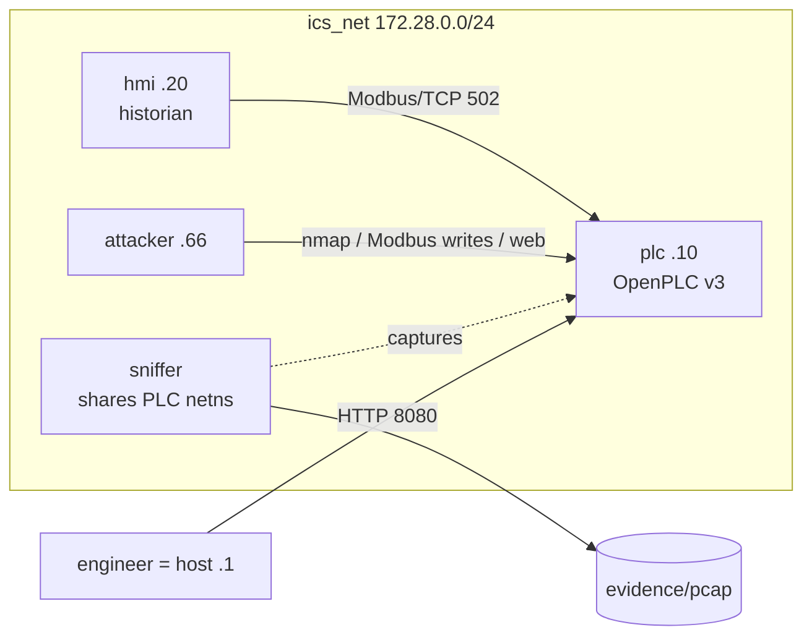

# ICS Digital Forensics Lab — Water Tank / OpenPLC

A self-contained, reproducible lab for a university report on **Digital Forensics
in Industrial Control Systems (ICS)**. It simulates a small industrial process
(a water tank) controlled by a real **OpenPLC Runtime v3** soft-PLC, lets you run
a realistic three-stage attack against it, and then perform a full forensic
investigation: **acquisition → analysis → unified incident timeline**.

Everything runs in Docker on **WSL2 (Ubuntu)**. Packet captures are opened with
Wireshark on Windows.

---

## 1. What the lab contains

| Service | IP | Role |
|---|---|---|
| `plc` | 172.28.0.10 | OpenPLC Runtime v3 (built from the official GitHub repo). Modbus/TCP **502**, web UI **8080** (exposed to the host). |
| `hmi` | 172.28.0.20 | Python HMI + historian: polls the PLC every second, logs to CSV (UTC ISO-8601). What the operator sees. |
| `attacker` | 172.28.0.66 | Python + pymodbus + nmap + curl. Idle; driven with `docker exec`. |
| `sniffer` | shares the PLC netns | `tcpdump` writing all PLC traffic to `evidence/pcap/`. |

All containers run on UTC, on an isolated bridge network `ics_net` (172.28.0.0/24).

```
            Windows host  (Wireshark, browser :8080)
                   │  \\wsl$  +  127.0.0.1:8080
┌──────────────────┴─────────────────────────────────────────┐
│  WSL2 Ubuntu  ·  Docker  ·  network ics_net 172.28.0.0/24   │
│                                                             │
│   ┌─────────────┐   Modbus/TCP 502    ┌─────────────┐       │
│   │    hmi      │ ──────────────────► │     plc     │ 8080  │
│   │ .20 historian│ ◄───────────────── │ .10 OpenPLC │◄──────── engineer (host → .1)
│   └─────────────┘   poll every 1 s    └──────┬──────┘       │
│                                              │ netns        │
│   ┌─────────────┐   nmap / Modbus     ┌──────┴──────┐       │
│   │  attacker   │ ──writes / web────► │   sniffer   │ tcpdump│
│   │ .66         │                     │ (pcap)      │──► evidence/pcap │
│   └─────────────┘                     └─────────────┘       │
└─────────────────────────────────────────────────────────────┘
```



---

## 2. The process & register map

A water tank, level `0..1000`. The pump fills it; the drain empties it. Pump
hysteresis: starts below the LOW setpoint, stops above the HIGH setpoint. A
critical-level safety cutoff forces the pump off above 950; an overflow bit
latches at 1000. The physics runs inside the PLC scan cycle (50 ms task, 1 s
integration tick).

**Modbus ↔ IEC address map** (verified against OpenPLC_v3 `core/modbus.cpp`):

| IEC var | Modbus object | Addr | FC (read/write) | Meaning | Who writes |
|---|---|---|---|---|---|
| `%QX0.0` | Coil | 0 | FC1 / FC5,15 | Pump running | PLC |
| `%QX0.1` | Coil | 1 | FC1 / FC5,15 | Drain valve open | PLC |
| `%QX0.2` | Coil | 2 | FC1 / FC5,15 | HIGH alarm (HMI) | PLC |
| `%QX0.3` | Coil | 3 | FC1 / FC5,15 | Overflow latched (HMI) | PLC |
| `%QW0`  | Holding reg | 0 | FC3 / FC6,16 | Level reported to HMI | PLC |
| `%MW0`  | Holding reg | 1024 | FC3 / FC6,16 | HIGH setpoint | engineer/attacker |
| `%MW1`  | Holding reg | 1025 | FC3 / FC6,16 | LOW setpoint | engineer/attacker |
| `%MW2`  | Holding reg | 1026 | FC3 / FC6,16 | Manual pump cmd (0/1) | engineer/attacker |
| `%MW10` | Holding reg | 1034 | FC3 / FC6,16 | **TRUE level (hidden)** | PLC |

Note: Modbus holding registers `0..1023 = %QW`, `1024..2047 = %MW` (so
`%MW0 = HR1024`). Input registers `%IW` (FC4) are written by physical I/O, not by
the program, so they stay 0 in this soft-PLC.

Two control programs live in `plc/programs/`:
- `water_tank_legit.st` — normal control with the safety cutoff and truthful HMI.
- `water_tank_malicious.st` — Stuxnet-style: safety cutoff disabled, alarm/overflow
  suppressed, and the HMI level (`%QW0`) **spoofed** while the true level stays in
  `%MW10`. The two files differ in only four clearly-marked lines (`diff` them).

---

## 3. Prerequisites

- Windows + **WSL2 (Ubuntu)** with **Docker Engine installed inside WSL** (not
  required to use Docker Desktop). Check from an Ubuntu shell:
  ```bash
  docker version         # client + server respond
  docker compose version # v2
  id -nG | grep docker   # your user is in the docker group (no sudo needed)
  ```
  If the daemon is not running: `sudo service docker start`.
- Internet access the first time (the PLC image clones OpenPLC_v3 and builds it).
- Wireshark on Windows to open `evidence/pcap/ics_capture.pcap` via
  `\\wsl.localhost\Ubuntu\…` (or your project path on `F:`).

This project lives on the Windows drive `F:` and is reached from WSL as
`/mnt/f/VILNIUS TECH/Cyber Forensics/Project`. All commands below are run from an
**Ubuntu (WSL) shell** in that directory:
```bash
cd "/mnt/f/VILNIUS TECH/Cyber Forensics/Project"
```

---

## 4. Run the experiment

```bash
# 1) Build + start the lab, configure OpenPLC (upload legit program, compile, run)
./scripts/00_setup.sh

# 2) Baseline: let it run normally, snapshot a clean baseline (+ SHA-256)
BASELINE_SECONDS=600 ./scripts/01_baseline.sh      # use 120 for a quick test

# 3) Attack: recon -> process manipulation -> logic tampering
./scripts/02_attack.sh

# 4) Acquire: live state, finalize pcap, docker forensics, copies, export, hashes
./scripts/03_acquire.sh

# 5) Analyse (Python venv in WSL)
#    Create the venv in your WSL home (ext4) — a venv on the /mnt/f drive is very
#    slow. The analysis scripts find the project by their own location, so the
#    venv can live anywhere.
python3 -m venv ~/ics-venv && source ~/ics-venv/bin/activate
pip install -r analysis/requirements.txt
python3 analysis/analyze_network.py
python3 analysis/analyze_plc.py
python3 analysis/analyze_historian.py
python3 analysis/build_timeline.py
python3 analysis/generate_report_appendix.py
```

Approx. timing: setup 3–8 min (first build), baseline as configured, attack ~6–8
min, acquisition 1–3 min (the `docker export` tar is the slow part), analysis < 1 min.

### Expected outputs at each step
- **00_setup** — `http://127.0.0.1:8080` dashboard shows *Water Tank Control v1.0*
  running; the Modbus snapshot prints sensible values (level rising/falling).
- **01_baseline** — `evidence/baseline/` with `openplc.db`, `st_files/`,
  `water_tank_legit.st`, `hashes.sha256`; `hmi/historian.csv` filling with an
  oscillating level and no alarm.
- **02_attack** — recon output under `evidence/attack/`; during phase 2 the HMI
  shows the level climbing and the **alarm firing**; after phase 3 the HMI looks
  **normal again** while the true level overflows.
- **03_acquire** — `evidence/acquisition/` with `live_registers.json`,
  `ics_capture.pcap`, `docker_diff_plc.txt`, `logs_*.txt`, `docker_inspect.json`,
  `openplc.db`, `st_files/`, `compiled/`, `plc_filesystem.tar`, `historian.csv`,
  `ground_truth.csv`, `hashes.sha256`, `chain_of_custody.csv` (read-only).
- **analysis** — under `evidence/analysis/`: `modbus_transactions.csv`,
  `modbus_unauthorized_writes.csv`, `http_requests.csv`, `network_summary.md`,
  `plc_*.csv`, `program_diff_*.txt`, `plc_summary.md`, `timeline.csv/md`,
  `figures/*.png`; and `docs/forensic_findings.md`.

---

## 5. Where the evidence lands

```
evidence/
├── operator_actions.log      # your lab notebook (UTC), part of the timeline
├── pcap/ics_capture.pcap      # live capture (open in Wireshark)
├── baseline/                  # clean baseline + hashes.sha256
├── attack/                    # recon (nmap, modbus enumeration)
├── acquisition/               # full forensic acquisition + chain_of_custody.csv
└── analysis/                  # CSVs, markdown summaries, figures/
```

---

## 6. Troubleshooting

- **Docker daemon not running** — `sudo service docker start` (inside WSL). This
  lab uses Docker *in WSL*; Docker Desktop is not required (keep it closed if it
  causes trouble).
- **Port 8080 already in use** — change the `plc` port mapping in
  `docker-compose.yml` (e.g. `"8090:8080"`), and pass `--base http://127.0.0.1:8090`
  if you run `openplc_web.py` manually.
- **OpenPLC build is slow / first run** — it clones and compiles OpenPLC
  (MatIEC, OpenDNP3, libmodbus, snap7). 5–10 min is normal. It is cached afterwards.
- **`Compilation finished with errors!`** — the uploaded `.st` didn't compile.
  Validate quickly: `docker exec -w /workdir/webserver ics-plc ./iec2c -f -l -p -r -R -a ./st_files/<file>`.
  (matiec requires located and non-located variables in *separate* `VAR` blocks.)
- **HMI/attacker can't reach the PLC on 502** — the runtime must be *started*
  (`/start_plc`). Modbus is enabled automatically because the OpenPLC setting
  `Modbus_port=502`.
- **`tshark` not found for analysis** — the analyzers fall back to running tshark
  inside the `nicolaka/netshoot` image automatically; just keep Docker running.
- **WSL networking / `\\wsl$` not visible** — `wsl --shutdown` then reopen Ubuntu.

---

## 7. Reset to a clean state

```bash
./scripts/reset.sh          # tears everything down and clears generated evidence
```
This stops and removes the containers **and the anonymous OpenPLC volume** (so the
database, uploaded programs and runtime state are wiped), and clears
`evidence/` and `hmi/*.csv`, leaving the source programs and scripts intact. Then
run `./scripts/00_setup.sh` again for a fresh experiment.

---

## 8. Documentation

- `docs/LIMITATIONS.md` — honest limitations of this lab vs a real ICS.
- `docs/forensic_findings.md` —  incident-investigation summary.
